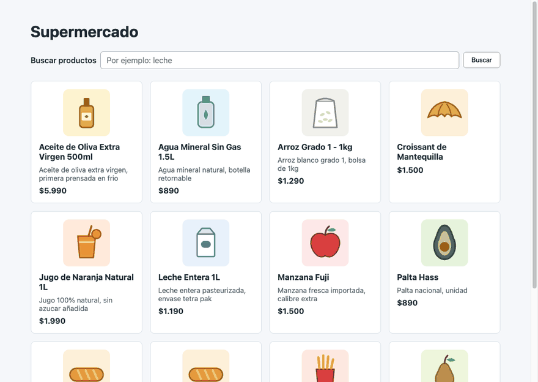
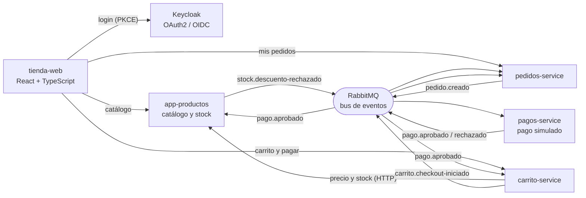

# Supermercado: ventas online para el comercio de barrio

[](https://github.com/llocado/app-productos/actions/workflows/tests.yml) [](https://github.com/llocado/carrito-service/actions/workflows/tests.yml) [](https://github.com/llocado/pedidos-service/actions/workflows/tests.yml) [](https://github.com/llocado/pagos-service/actions/workflows/tests.yml) [](https://github.com/llocado/tienda-web/actions/workflows/tests.yml)

> **In English, in short:** a portfolio project that models the online sales of a neighbourhood supermarket as five small services
> (catalog, cart, orders, payments, web store) talking through RabbitMQ events and secured with Keycloak (OAuth2 + PKCE). It focuses on the
> hard parts of distributed systems: hexagonal architecture, transactional outbox, idempotent consumers, optimistic locking, dead-letter queues
> and failure testing against real services. 749 automated tests, mutation testing, and a React + TypeScript storefront (built step by step with AI assistance while learning front end) verified in a real
> browser. Documentation is in Spanish; the diagrams in [`docs/flujo-completo.md`](docs/flujo-completo.md) are self-explanatory.

Sistema de ventas online para un supermercado de barrio: catálogo, carrito, pedido, pago y stock, repartidos en servicios pequeños que se
hablan por **eventos**. El pago es simulado a propósito; lo que importa aquí es cómo se comporta el sistema cuando algo falla.



*Un recorrido real: búsqueda, login en Keycloak, agregar desde el listado con la cantidad elegida, carrito, **Pagar** y el pedido que pasa a "Pagado" cuando los eventos entre servicios terminan.*

## Probar en 5 minutos

Solo necesitas **Docker** (con unos 4 GB de RAM libres para Docker) y `git`. No hace falta Java, Node ni ningún token:

```bash
git clone https://github.com/llocado/supermercado.git
cd supermercado
./demo.sh
```

La primera vez compila los cuatro servicios y la tienda desde sus repositorios públicos (**unos 5 minutos**, medido en un MacBook; las siguientes
veces arranca en menos de un minuto). Al terminar, abre **http://localhost:5173**, entra con `cliente1` / `cliente1` (usuario solo de la demo),
agrega productos y pulsa **Pagar** en el carrito: el pedido pasa a *Pagado* cuando los eventos viajan por RabbitMQ entre los servicios. Un total
sobre 100.000 CLP se rechaza a propósito. Para apagar todo y borrar los datos: `./demo-down.sh`.

- Todo queda ligado a `127.0.0.1` (nada es visible desde tu red) y las bases de datos no se publican.
- La demo construye **versiones fijas** de cada repositorio (los commits están en [`.env`](.env)), así que sigue funcionando aunque los repositorios avancen.
- `demo.sh` espera a que existan **todas las colas** de RabbitMQ antes de dar el sistema por listo y carga 15 productos de ejemplo.
- Puertos usados: 5173 (tienda), 8080–8083 (servicios), 8180 (Keycloak) y 15672 (consola de RabbitMQ, `supermercado` / `supermercado`).

## Lo que conviene mirar primero (5 minutos)

1. **El flujo de una compra, con diagramas:** [`docs/flujo-completo.md`](docs/flujo-completo.md) — del carrito al pedido pagado y al stock
   descontado, y qué pasa cuando el pago se rechaza o ya no hay stock.
2. **Una decisión de diseño que se nota:** el *outbox* de [`pagos-service`](https://github.com/llocado/pagos-service) — un pago aprobado nunca se
   pierde ni se duplica, aunque RabbitMQ se caiga justo después de aprobarlo.
3. **Cómo se prueba:** [`pedidos-service`](https://github.com/llocado/pedidos-service) y [`carrito-service`](https://github.com/llocado/carrito-service)
   (Testcontainers, tests de concurrencia, mensajes venenosos) y el front [`tienda-web`](https://github.com/llocado/tienda-web).
4. **Lo que todavía no está resuelto, sin maquillar:** [`docs/riesgos-conocidos.md`](docs/riesgos-conocidos.md).

## Arquitectura



Cada servicio tiene **su propia base de datos** y su propio modelo de dominio; nadie lee la base de otro. Solo `carrito` llama por HTTP a otro
servicio (a `productos`, para fijar precio y avisar de stock); todo lo demás viaja por eventos.

| Repositorio | Qué es | Stack |
|---|---|---|
| [`app-productos`](https://github.com/llocado/app-productos) | Catálogo y **único dueño del stock** | Spring Boot 4, Java 21, Postgres, Liquibase |
| [`lib-domain-foods`](https://github.com/llocado/lib-domain-foods) | Dominio del catálogo, publicado como paquete | Java, GitHub Packages |
| [`carrito-service`](https://github.com/llocado/carrito-service) | Carrito por usuario autenticado; inicia el checkout | Spring Boot, JWT, RabbitMQ |
| [`pedidos-service`](https://github.com/llocado/pedidos-service) | Crea pedidos desde eventos y sigue su estado | Spring Boot, RabbitMQ, Postgres |
| [`pagos-service`](https://github.com/llocado/pagos-service) | Pago simulado con *outbox* transaccional | Spring Boot, RabbitMQ, Postgres |
| [`tienda-web`](https://github.com/llocado/tienda-web) | La tienda: catálogo, login, carrito, pagar, pedidos. **Área en aprendizaje**: se construyó por pasos con IA | React 19, TypeScript estricto, Vite, Vitest |
| `supermercado-infra` | Keycloak y RabbitMQ para desarrollo (repo privado: trae credenciales de desarrollo). La demo de arriba trae su propio compose | Docker Compose |

## Qué demuestra

| Tema | Cómo está resuelto | Dónde verlo |
|---|---|---|
| **Arquitectura hexagonal** | `domain` / `application` (casos de uso y puertos) / `infrastructure` (adaptadores); el dominio del catálogo vive en una biblioteca aparte. | cualquier servicio, README de [`app-productos`](https://github.com/llocado/app-productos) |
| **Mensajería fiable** | *Outbox* transaccional, publicación con `mandatory` y confirmaciones, reintentos acotados (1 + 3) y DLQ, consumidores **idempotentes** por `eventId`. | [flujo §4–6](docs/flujo-completo.md) |
| **Consistencia y concurrencia** | Bloqueo optimista (`@Version`), descuento de stock "todo o nada", `saveAndFlush` para que un fallo de INSERT ocurra **antes** de publicar, claves de idempotencia en el checkout. | [flujo §10](docs/flujo-completo.md), README de `pedidos-service` |
| **Seguridad** | Keycloak (OAuth2/OIDC), servicios como *Resource Server* JWT, login del front con **PKCE** y token solo en memoria, CORS con origen explícito, logs sin secretos. | [riesgos](docs/riesgos-conocidos.md), [flujo §8](docs/flujo-completo.md) |
| **Pruebas** | Unitarias, de integración con Postgres y RabbitMQ reales (Testcontainers), de mutación (PIT), de fallo con servicios reales y de interfaz en un navegador real. | tabla de abajo |
| **Front (en aprendizaje)** | React 19, TypeScript estricto, datos de la red validados con *type guards*, la URL como estado, límite de errores, espera acotada del pedido (consistencia eventual). | [`tienda-web`](https://github.com/llocado/tienda-web) |
| **Operación** | Logging `clave=valor` con `requestId`/`correlationId`, volumen de log medido con dependencias caídas, migraciones con Liquibase. | README de cada servicio |

### En números (medidos al 2026-11-03)

| | Pruebas | Mutación (PIT) |
|---|---|---|
| `lib-domain-foods` | 72 | 62 % |
| `app-productos` | 118 (87 + 31 de integración) | 91 % |
| `carrito-service` | 164 (130 + 34) | 73 % |
| `pedidos-service` | 124 (97 + 27) | 73 % |
| `pagos-service` | 89 (78 + 11) | 85 % |
| `tienda-web` | 182 | — |
| **Total** | **749**, todas en verde | |

La mutación mide el dominio y los casos de uso: cambia el código en pequeño y comprueba que algún test falle. Es informativa, no un umbral.

## Decisiones que vale la pena discutir

- **El checkout responde `202`, no `200`.** El pedido se crea después, por evento; la tienda espera con consultas acotadas hasta que aparece.
  Es consistencia eventual explícita, no un detalle oculto.
- **El stock se descuenta al pagar, no al agregar al carrito.** Sin reservas hay más carritos que unidades, y el caso "pagó pero ya no había"
  termina en un pedido `SIN_STOCK`. Se eligió por simplicidad y está documentado como límite.
- **Duplicar un poco el modelo es intencional.** `carrito` y `pedidos` guardan su propia "foto" del producto en vez de importar el dominio de
  `productos`: así cada servicio se despliega y evoluciona solo.
- **El pago es determinista a propósito** (se rechaza sobre 100.000 CLP): se puede probar el rechazo en tests, en la interfaz y en las pruebas
  de fallo.
- **Las pruebas de fallo se hacen con servicios reales**, rompiéndolos a propósito (dependencia caída, host inalcanzable, mensaje venenoso,
  concurrencia). Así aparecieron problemas que ningún test automático veía: un bucle de reintentos que escribía **115 MB de log**, un pool de base
  de datos que esperaba 30 s, un log de acceso que decía 200 en un 500, y en el front un campo de búsqueda que perdía el foco.

## Cómo se construyó (y el papel de la IA)

El proyecto se desarrolló con **Claude Code** como asistente, y se dejó la forma de trabajo escrita en el propio repositorio:

- **Reglas por escrito** (`CLAUDE.md` en cada repo): arquitectura, commits en español con *Conventional Commits*, niveles de log, qué nunca se registra,
  y la regla de verificar con servicios reales y no solo con tests.
- **Comandos propios** para tareas repetidas (nuevo endpoint, nuevo evento, explicar un archivo, pruebas de fallo) y **hooks** que hacen cumplir las
  reglas: uno valida el formato de los commits y pide confirmación antes de un `push`; otro ejecuta el chequeo de tipos y el lint del front tras cada edición.
- **Revisión independiente**: se lanzaron revisores en paralelo (uno por repositorio) antes de publicar; cada hallazgo se **verificó leyendo el código**
  antes de actuar, y uno de ellos no se reprodujo y se descartó.
- **Verificación en un navegador real** controlado por su protocolo de depuración, además de los tests.

El **front-end es el área en la que el autor está aprendiendo**: la tienda se construyó por pasos con IA, explicando cada concepto, y sirve para mostrar el sistema completo; el foco y la experiencia del autor están en el backend. Las decisiones de arquitectura, qué se publica y qué se descarta las toma la persona; la IA acelera, propone y verifica, pero no hace *commit* ni *push*
sin confirmación explícita.

## Documentación

- [`docs/flujo-completo.md`](docs/flujo-completo.md) — el recorrido completo con diagramas (Mermaid)
- [`docs/glosario.md`](docs/glosario.md) — los conceptos (outbox, idempotencia, DLQ, PKCE...)
- [`docs/negocio.md`](docs/negocio.md) — para quién es y por qué (caso simulado, B2B2C, comercio de barrio en Chile)
- [`docs/riesgos-conocidos.md`](docs/riesgos-conocidos.md) — qué se resolvió y qué falta antes de un despliegue real

## Autor

**llocado** · GitHub: [github.com/llocado](https://github.com/llocado) · Correo: [icollado.m@gmail.com](mailto:icollado.m@gmail.com)

> Proyecto de portafolio con un caso de negocio **simulado**: las cifras marcadas con 🔶 en [`docs/negocio.md`](docs/negocio.md) son hipótesis, no datos de mercado.
