# Cómo funciona todo: el flujo completo

Este documento responde: **¿qué pasa, paso a paso, desde que un cliente agrega una manzana al carrito hasta que su pedido queda pagado?** y **¿quién habla con quién?** Los diagramas son [Mermaid](https://mermaid.js.org/): GitHub los dibuja directamente.

Para el detalle de cada servicio, mira el README de su repositorio (enlaces en el [README principal](../README.md)) y el [glosario](glosario.md) para los términos.

---

## 1. El mapa general: quién es quién

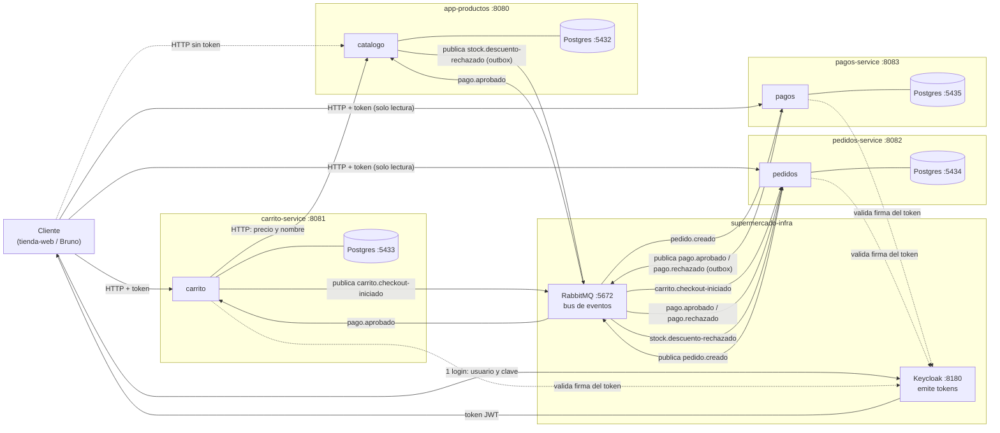

**Cómo leerlo**
- Las **flechas con texto "HTTP"** son llamadas directas y bloqueantes (se espera la respuesta).
- Las que pasan por **RabbitMQ** son **asíncronas**: quien publica no espera; el consumidor lo procesa cuando puede.
- Cada servicio tiene **su propia base de datos** y nadie más la toca. Si pedidos necesita algo de carrito, no consulta su BD: recibe un evento.
- Solo `carrito` llama por HTTP a otro servicio (a `productos`, para saber el precio y el stock). Todo lo demás es por eventos.
- `productos` es el **único dueño del stock**: lo descuenta al recibir `pago.aprobado` y solo publica si **no** alcanza (`stock.descuento-rechazado`).

---

## 2. El camino feliz, paso a paso (compra que se aprueba)

En una frase: el cliente llena su carrito, pide pagar, y desde ahí los servicios se avisan entre sí con mensajes hasta que el pedido queda **PAGADO**. Son 4 fases; cada una tiene su propio diagrama corto y una explicación en palabras simples.

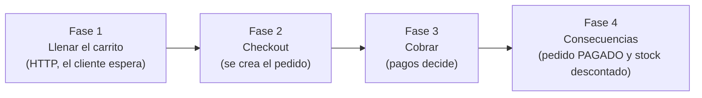

**Antes de todo:** el cliente inicia sesión en Keycloak con usuario y clave y recibe un **token JWT**. Ese token viaja en cada llamada HTTP que haga después.

### Fase 1: llenar el carrito (síncrono)

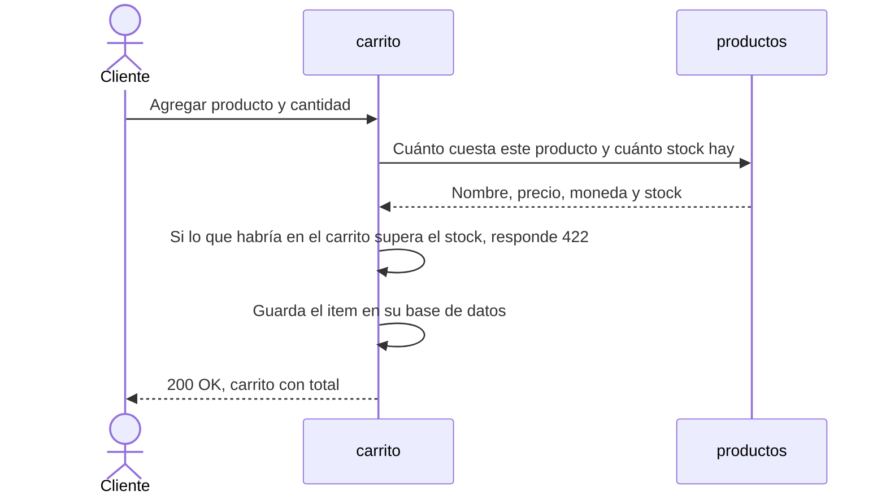

Es una conversación normal: el cliente pregunta y espera la respuesta. `carrito` es el único servicio que llama por HTTP a otro (`productos`), porque necesita el precio real y no puede fiarse del que mande el cliente. De paso le pregunta el **stock**: si no alcanza, avisa de inmediato (es un aviso temprano, no una garantía: la garantía es el descuento de la fase 4).

### Fase 2: checkout (aquí empiezan los mensajes)

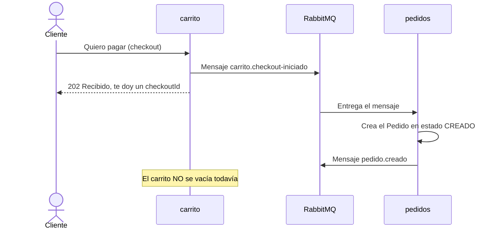

Fíjate en el orden: `carrito` responde **202** al cliente *antes* de que el pedido exista. 202 significa "recibido, lo estoy procesando". El pedido se crea después, cuando `pedidos` recibe el mensaje.

### Fase 3: cobrar

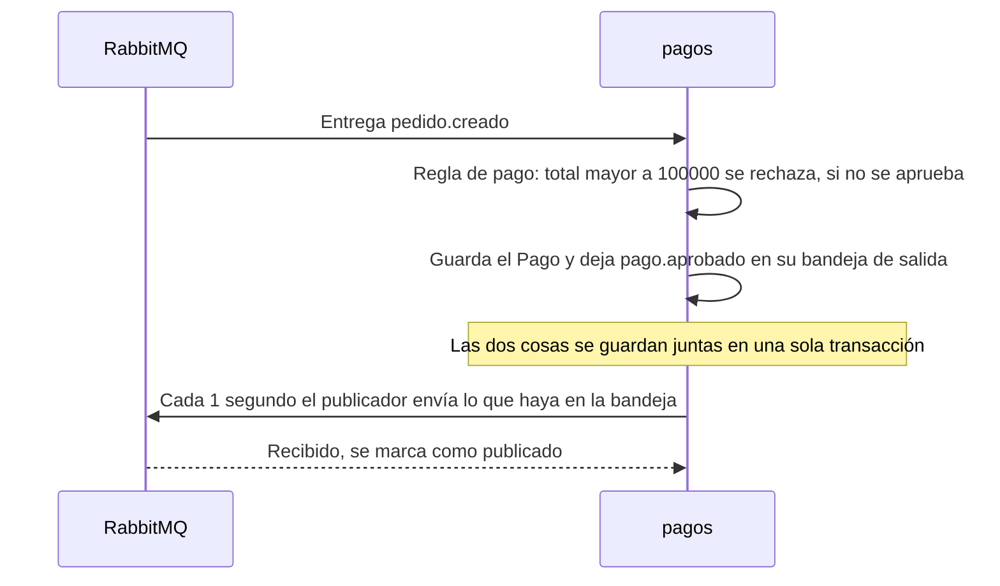

Esta es la fase más delicada. `pagos` no publica el mensaje directamente: primero lo escribe en una "bandeja de salida" (el **outbox**) junto con el pago, en la misma transacción. Así, o se guardan las dos cosas o ninguna. Después, un proceso aparte (`PublicadorOutbox`) lee la bandeja y la manda a RabbitMQ. Si algo falla en medio, el mensaje sigue en la bandeja y se reintenta; no se pierde.

### Fase 4: consecuencias del pago (en paralelo)

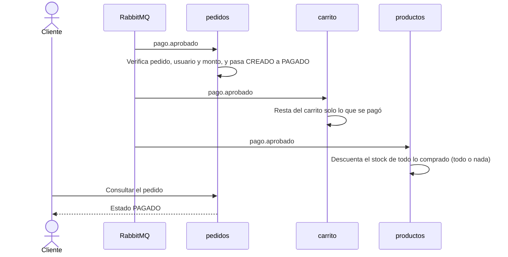

El mismo mensaje `pago.aprobado` llega a **tres** servicios y cada uno hace lo suyo sin esperar a los otros. Si el cliente agregó algo al carrito después del checkout, eso se conserva. Si en `productos` no alcanza el stock, ver la sección 3b.

**Puntos que conviene entender**

1. **El checkout devuelve `202`, no `200`:** "recibido, se está procesando". El pedido aún no existe cuando respondes.
2. **El `checkoutId` es el hilo conductor:** es el `eventId` del primer mensaje y el `correlationId` de **todos** los siguientes. Buscándolo en los logs de los 4 servicios ves toda la compra.
3. **El carrito no se vacía al hacer checkout**, sino cuando el pago se aprueba (y solo lo comprado). Por eso, si el pago se rechaza, el cliente conserva su carrito.
4. **El stock se descuenta al pagar, no al agregar al carrito.** Agregar solo *avisa*; el descuento de la fase 4 es el árbitro.
5. **La fase 3 usa outbox** para no perder mensajes: pago y mensaje de salida se confirman juntos o no se confirma nada.

---

## 3. Cuando el pago se rechaza

El recorrido es idéntico al camino feliz hasta la **Fase 3**. La diferencia aparece cuando `pagos` aplica su regla y el total supera el límite (ejemplo: pedido de 150000).

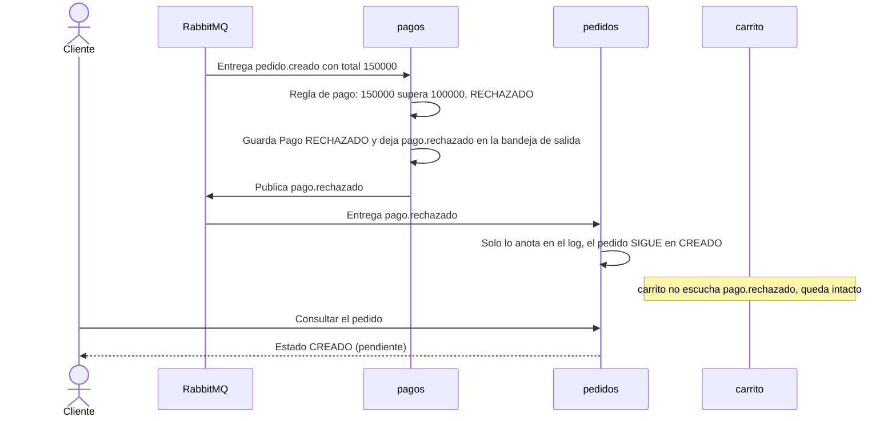

**Comparación rápida**

| | Pago aprobado | Pago rechazado |
|---|---|---|
| Mensaje que publica `pagos` | `pago.aprobado` | `pago.rechazado` (motivo `MONTO_EXCEDE_LIMITE`) |
| Qué hace `pedidos` | CREADO pasa a PAGADO | Solo escribe en el log; sigue en CREADO |
| Qué hace `carrito` | Resta lo pagado | Nada: no escucha este mensaje |
| Qué hace `productos` | Descuenta el stock | Nada: no escucha este mensaje |
| Resultado para el cliente | Pedido PAGADO, carrito y stock descontados | Pedido pendiente, carrito y stock intactos |

El pedido queda **pendiente** (decisión de diseño cerrada). El reintento de pago es un pendiente fuera de alcance.

---

## 3b. Cuando el pago se aprueba pero ya no hay stock

Entre agregar al carrito y pagar, otro cliente pudo comprar la última unidad. No hay reserva: el descuento al pagar es el árbitro.

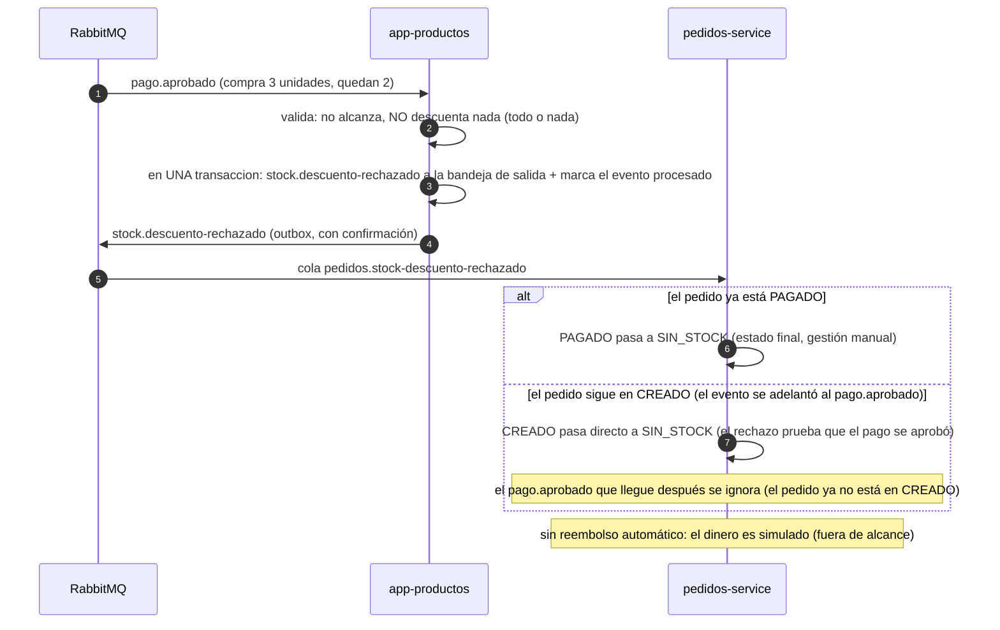

- Si dos pagos compiten por la **última unidad**, `@Version` hace que uno confirme y el otro falle por conflicto; se reintenta, ve el stock en 0 y se rechaza. Nunca queda stock negativo ni se vende dos veces.
- Si el éxito es silencioso (no hay evento `stock.descontado`), pedidos solo se entera de los fallos.

---

## 4. La topología de RabbitMQ: exchanges, colas y DLQ

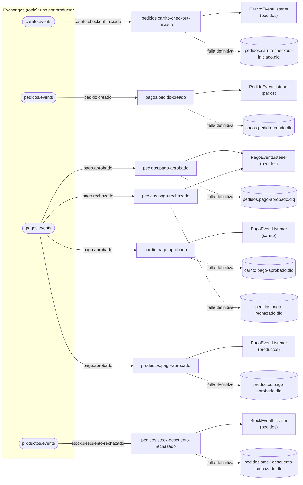

- Un **exchange por servicio productor**; la *routing key* es el nombre del evento.
- **Cada consumidor tiene su propia cola**: `pago.aprobado` va a **tres** colas (pedidos, carrito y productos) y cada uno la procesa a su ritmo.
- Cada cola tiene su **DLQ** (a través del exchange `*.dlx` del consumidor).
- Cada servicio **declara** (de forma idempotente) los exchanges ajenos que necesita, para poder enlazar su cola aunque el otro servicio no haya arrancado.

---

## 5. ¿Qué pasa cuando un evento falla? (el árbol de decisión del listener)

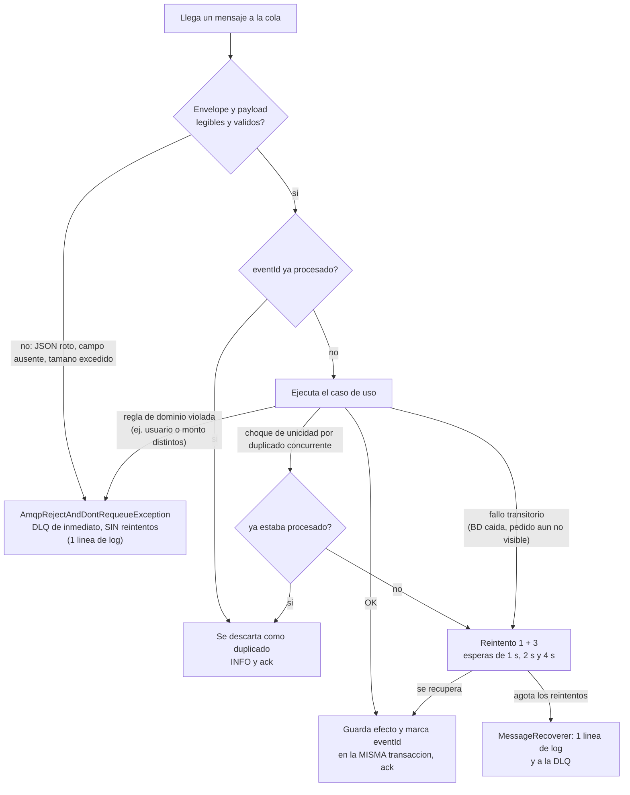

**La regla de oro:** un mensaje que falla **nunca** vuelve a la cola sin límite (`default-requeue-rejected: false`). Antes de esta regla, un solo mensaje malo llegó a generar 115 MB de log en 6 segundos.

---

## 6. El outbox de pagos (y de productos): cómo se publica sin perder nada

El problema que resuelve: si pagos guarda el pago y **después** publica el evento, un fallo entre las dos cosas deja un pago sin aviso (o un aviso de un pago que nunca se guardó).

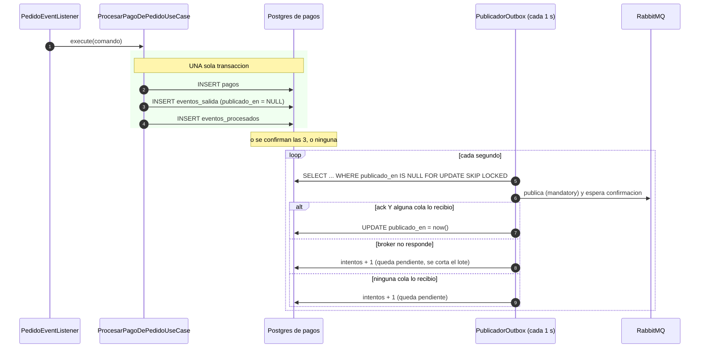

- Si el servicio muere entre guardar y publicar, **el evento sigue en la tabla** y se publica al reiniciar.
- Si muere entre publicar y marcar `publicado_en`, se publica **dos veces**. No importa: los consumidores son idempotentes (por eso la garantía es *at-least-once*).
- El `eventId` del evento es **determinista** (`tipo + pagoId`), así el mismo evento siempre tiene el mismo id.
- `app-productos` usa **el mismo patrón** para publicar `stock.descuento-rechazado` (su bandeja es `eventos_salida`, el cartero es su propio `PublicadorOutbox`).

---

## 7. Por dentro de un servicio: el recorrido de una petición HTTP

Ejemplo: `POST /api/carrito/items`.

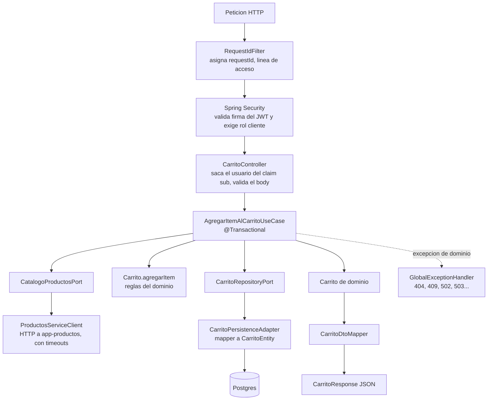

La flecha es siempre **hacia adentro**: `infrastructure → application → domain`. El dominio no importa nada de los demás; los casos de uso solo conocen **puertos** (interfaces).

---

## 8. Seguridad: cómo se sabe quién eres

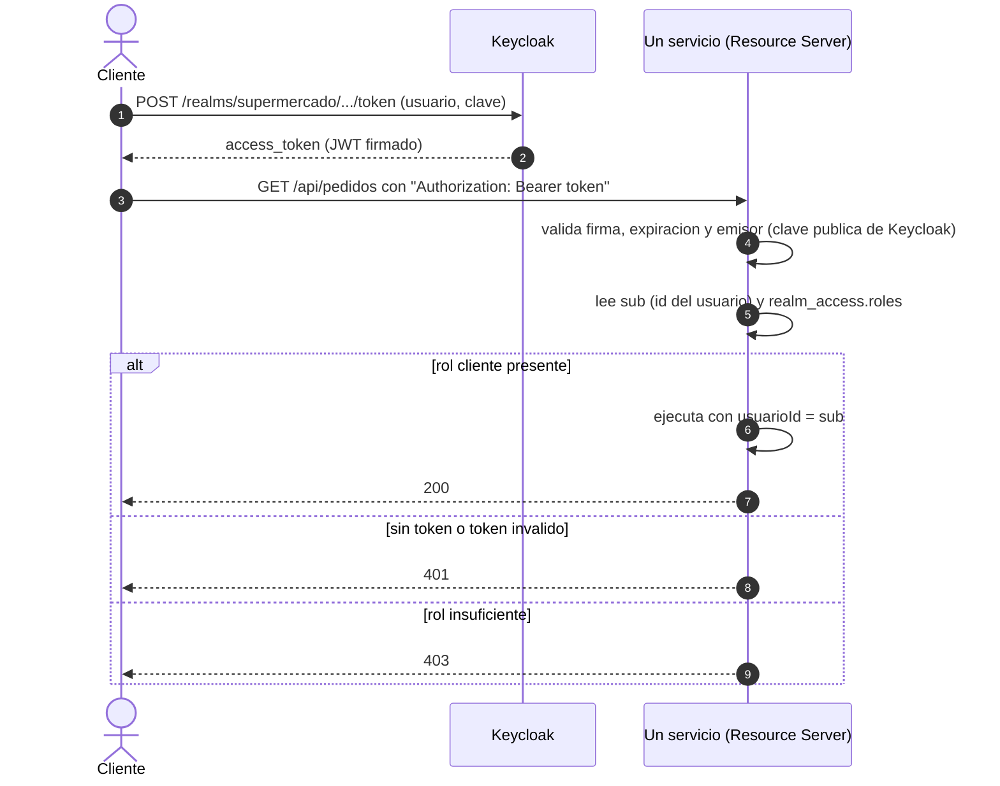

- El servicio **no guarda contraseñas ni sesiones**; solo verifica la firma.
- El `usuarioId` **siempre** sale del `sub` del token, nunca del body ni de la URL.
- Recursos de otro usuario responden **404** (igual que "no existe") para no revelar que el id es válido.
- **`app-productos` no tiene seguridad todavía** (pendiente documentado).

---

## 9. Ciclo de vida del pedido

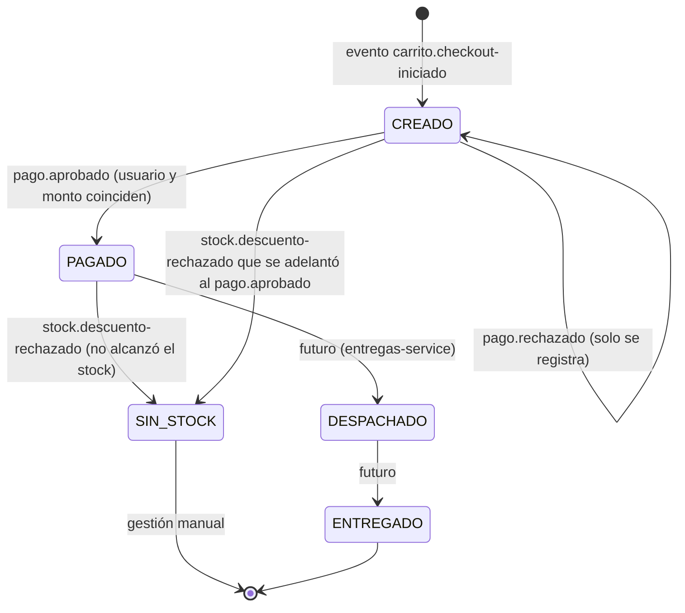

Solo se puede avanzar **un paso** (`EstadoPedido.puedeTransicionarA`). `DESPACHADO` y `ENTREGADO` existen en el modelo pero ningún flujo los usa todavía. `SIN_STOCK` es una **rama lateral**: se llega desde `PAGADO` (o desde `CREADO` si el rechazo se adelantó al pago) y no se sale (no forma parte del orden lineal, por eso el código lo trata aparte).

---

## 10. Dos escritores sobre el mismo carrito (bloqueo optimista)

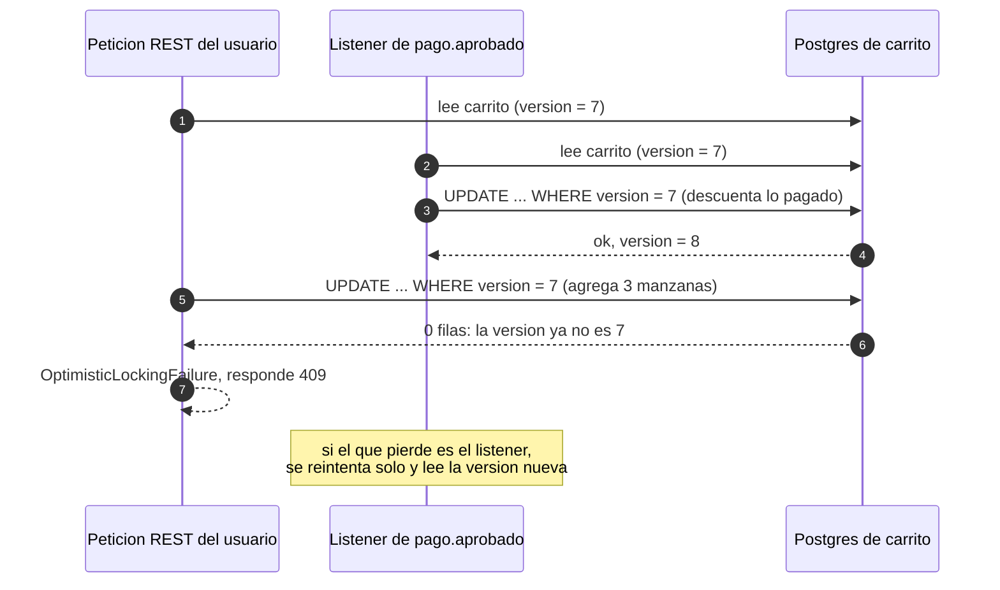

Sin `@Version`, el segundo en guardar **pisaba en silencio** al primero y el usuario perdía lo recién agregado. `app-productos` usa lo mismo en `productos.version`: dos pagos que descuentan el mismo stock no se pisan.

---

## 10b. Dónde entra la tienda web

El cliente no usa Bruno: usa un navegador. La **tienda web** (`tienda-web`, React + TypeScript, puerto 5173) se sienta *delante* de los servicios y les habla por HTTP, igual que Bruno, pero desde el navegador del cliente.

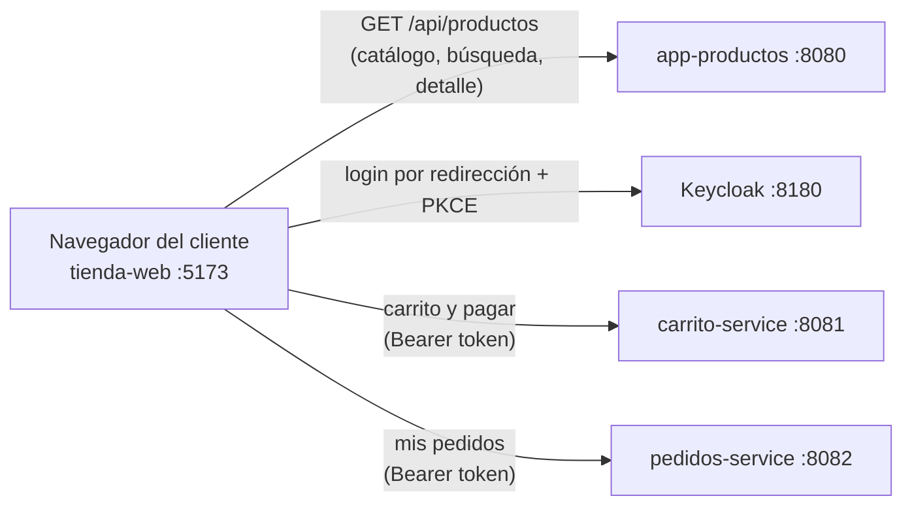

El front cubre: catálogo con búsqueda y detalle, login, carrito (agregar, cambiar cantidad, quitar, vaciar), **pagar** y **Mis pedidos**. Como `POST /checkout` responde `202`, el pedido aún no existe al volver a la pantalla: "Mis pedidos" consulta cada 1,5 s (máximo ~20 s) hasta que aparece y sale de `CREADO` (consistencia eventual). Un reintento de pago con la misma `Idempotency-Key` no duplica el pedido.

Como no hay *API Gateway*, el front conoce tres direcciones distintas y cada servicio debe autorizar su origen con CORS. El token vive solo en memoria de la pestaña (nada en `localStorage` ni cookies). El resto del recorrido —eventos, pagos, stock— no cambia: el front solo reemplaza a Bruno como cliente.

---

## 11. Datos: qué guarda cada servicio

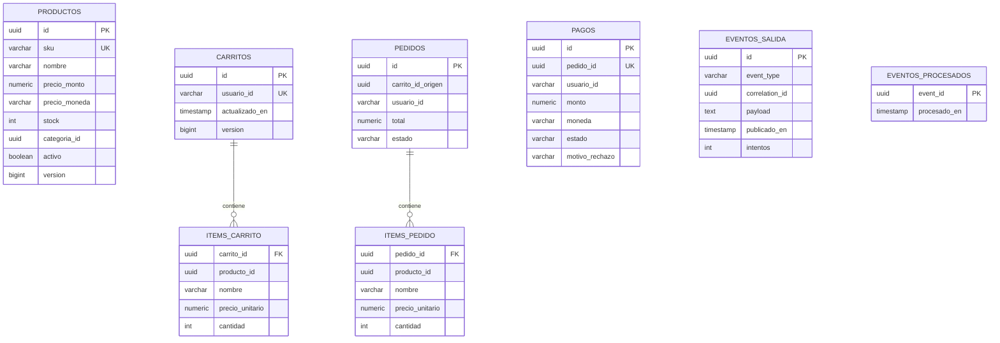

- Cada servicio tiene **su propia base**; `EVENTOS_PROCESADOS` existe en carrito, pedidos, pagos y productos (idempotencia) y `EVENTOS_SALIDA` en pagos y productos (outbox).
- **No hay claves foráneas entre servicios** (`carrito_id_origen`, `pedido_id`, `producto_id` son ids "por referencia", no relaciones de base): cada servicio es dueño de su dato.
- Los ítems guardan una **foto** de nombre y precio al momento de agregarlos, así un cambio posterior de precio no altera un carrito ni un pedido ya creado.

---

## 12. Dónde mirar cuando algo falla

| Síntoma | Dónde mirar |
|---|---|
| Un evento no tuvo efecto | La **DLQ** del consumidor (UI de RabbitMQ `http://localhost:15672`) y el log con su `eventId`. |
| Seguir una compra completa | Buscar el `checkoutId` (= `correlationId`) en los logs de los 4 servicios. |
| Un error en una petición HTTP | El header `X-Request-Id` de la respuesta → buscar ese `requestId` en el log. |
| Un pago aprobado que no llegó a pedidos o carrito | Tabla `eventos_salida` de pagos: ¿`publicado_en` es `NULL`? (ver sección 6). |
| Un pedido que sigue en `CREADO` | ¿Hubo `pago.rechazado`? (sección 3). ¿Hay mensajes en `pedidos.pago-aprobado.dlq`? |
| Un pedido en `SIN_STOCK` | La tabla `eventos_salida` de productos (¿qué faltó?) y el log de productos con el `pagoId`/`correlationId` (sección 3b). |
| Un pago aprobado cuyo stock no bajó | Cola `productos.pago-aprobado` y su DLQ; log de productos con el `eventId`. |
| Limpiar datos de prueba | El script de reinicio de datos del repo de infraestructura (privado) o, en la demo, `./demo-down.sh` |
